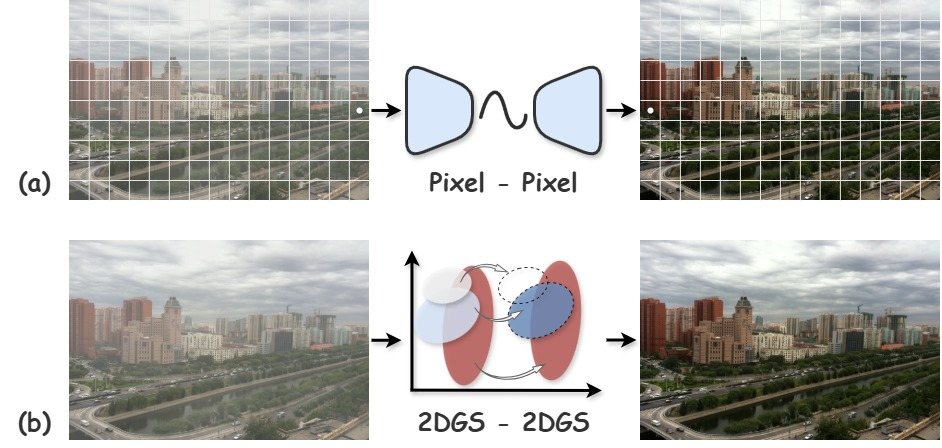
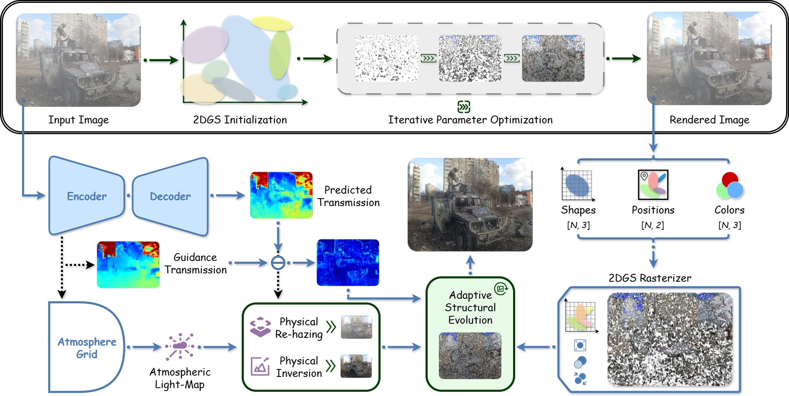
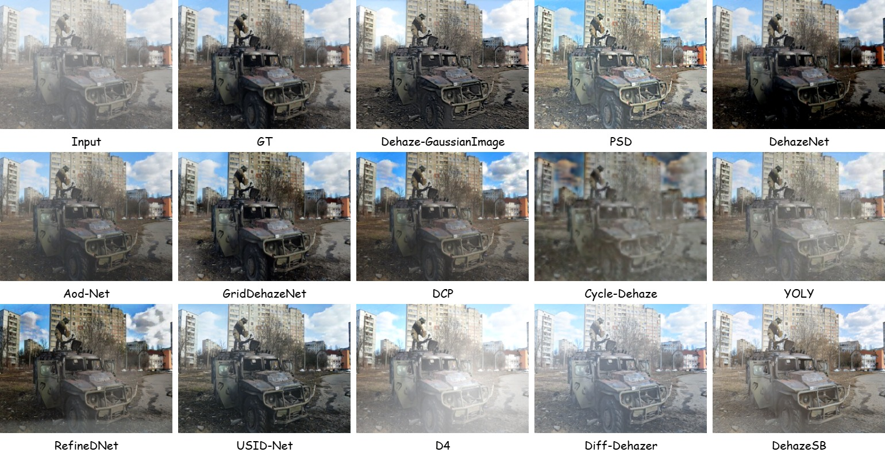
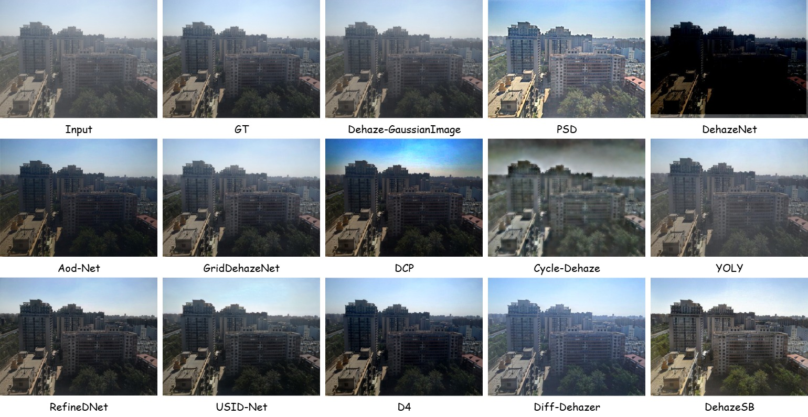

# Dehaze-GaussianImage

**Dehaze-GaussianImage: Zero-shot dehazing via Explicit 2D Gaussian splatting representation**

**Yuhan Chen**, Wenxuan Yu, Guofa Li, Kunyang Huang, Ying Fang, Yicui Shi, Wenbo Chu, and Keqiang Li

**Optics & Laser Technology**, Volume 204, Article 116787, 2026

📄 **[Paper (ScienceDirect)](https://www.sciencedirect.com/science/article/pii/S0030399226021389)** | **[DOI](https://doi.org/10.1016/j.optlastec.2026.116787)**

This repository provides a **single-image demonstration implementation** of *Dehaze-GaussianImage*, a zero-shot image dehazing framework based on explicit 2D Gaussian Splatting (2DGS).

> **Important — Demo code, not an exact reproduction of the paper.** The current public implementation is intended for demonstrating dehazing results on individual images. Some configurations and implementation details differ from those used in the published paper. Parameters may need to be adjusted for different images and datasets to obtain the best visual results. This code is provided **for reference only**; it should not be assumed to reproduce the paper's reported quantitative results directly.

## Overview

Most image dehazing approaches process images on a fixed pixel grid. In contrast, **Dehaze-GaussianImage** represents image content using a compact, continuous field of anisotropic 2D Gaussian primitives and performs zero-shot optimization guided by the atmospheric scattering model.

The framework comprises two main stages:

1. **Explicit Hazy Representation:** Reconstruct the input hazy image with an explicit 2D Gaussian field.
2. **Physics-Disentangled Evolution:** Estimate the transmission map and spatially varying atmospheric light, and optimize the Gaussian scene-radiance representation under physics-based reconstruction constraints. Adaptive Gaussian evolution reallocates representation capacity to newly recovered scene details.

The approach requires **no external training dataset or pretrained model weights** for per-image optimization. For the full methodology, experimental protocol, and quantitative results, please refer to the [published paper](https://www.sciencedirect.com/science/article/pii/S0030399226021389).

## Method

### Figure 1 — Pixel-domain vs. Gaussian-domain Dehazing



*Figure 1 in the paper. Comparison between conventional pixel-domain dehazing and dehazing in an explicit 2D Gaussian representation domain.*

### Figure 2 — Overall Framework



*Figure 2 in the paper. The two-stage framework combines explicit hazy-image reconstruction with physics-disentangled Gaussian optimization.*

## Visual Results

### NID Dataset



*Qualitative visualization of dehazing results on the NID dataset.*

### SOTS Dataset



*Qualitative visualization of dehazing results on the SOTS dataset.*

## Getting Started

### 1. Requirements

The following environment is recommended for **NVIDIA RTX 30-series, A100, and A800 GPUs**:

* Python 3.10
* PyTorch 2.1.0
* CUDA 12.1
* torchvision 0.16.0
* torchaudio 2.1.0

A CUDA-capable NVIDIA GPU and a compatible CUDA build toolchain are needed to build the `gsplat2d` extension.

### 2. Installation

Clone the repository:

```bash
git clone --recursive https://github.com/YuhanChen2024/Dehaze-GaussianImage.git
cd Dehaze-GaussianImage
```

Create and activate a Python environment:

```bash
conda create -n dehaze-gaussianimage python=3.10 -y
conda activate dehaze-gaussianimage
```

Install PyTorch with CUDA 12.1 support:

```bash
pip install torch==2.1.0 torchvision==0.16.0 torchaudio==2.1.0 --index-url https://download.pytorch.org/whl/cu121
```

Install the remaining dependencies:

```bash
pip install constriction pandas pillow pytorch-msssim PyYAML tqdm ninja
pip install "opencv-contrib-python<4.12"
pip install "numpy<2"
```

Build and install the 2D Gaussian Splatting extension:

```bash
cd gsplat2d
python setup.py build
python setup.py install
cd ..
```

### 3. Run the Demo

From the repository root, run:

```bash
python A_main_pipeline_v5_1.py
```

The current implementation is designed for **single-image visualization**. Before running on another image, inspect the input configuration and adjust the relevant parameters in the script as needed.

## Important Notes

* **Demonstration scope:** This release focuses on visually demonstrating dehazing for an individual input image, rather than providing a complete benchmark evaluation pipeline.
* **Differences from the paper:** The configurations of the released code are not identical to the experimental settings described in the published article.
* **Image-specific tuning:** Different datasets, haze conditions, and images may require different parameter settings to achieve satisfactory results.
* **Reproducibility:** Please consult the paper for the full method and experimental details. The released demo is provided as a reference and should not be treated as an exact reproduction of all published results.

## Acknowledgements

This implementation draws inspiration from and references the following excellent open-source projects:

* **[LIG — Large Images are Gaussians](https://github.com/HKU-MedAI/LIG)**: *Large Images are Gaussians: High-Quality Large Image Representation with Levels of 2D Gaussian Splatting* (AAAI 2025).
* **[LL-GaussianImage](https://github.com/YuhanChen2024/LL-GaussianImage)**: *Efficient Image Representation for Zero-shot Low-Light Enhancement with 2D Gaussian Splatting*.

We sincerely thank the authors of these projects for their valuable contributions and for making their work publicly available.

## Citation

If you find this project or our research useful, please consider citing our paper:

```bibtex
@article{Chen2026DehazeGaussianImage,
  title   = {Dehaze-GaussianImage: Zero-shot dehazing via Explicit 2D Gaussian splatting representation},
  author  = {Chen, Yuhan and Yu, Wenxuan and Li, Guofa and Huang, Kunyang and Fang, Ying and Shi, Yicui and Chu, Wenbo and Li, Keqiang},
  journal = {Optics \& Laser Technology},
  volume  = {204},
  pages   = {116787},
  year    = {2026},
  doi     = {10.1016/j.optlastec.2026.116787},
  url     = {https://www.sciencedirect.com/science/article/pii/S0030399226021389}
}
```

## Contact

For questions or discussions, please feel free to contact **Yuhan Chen** or open an issue in this repository.

## License

This repository is distributed under the [Apache License 2.0](./LICENSE).
